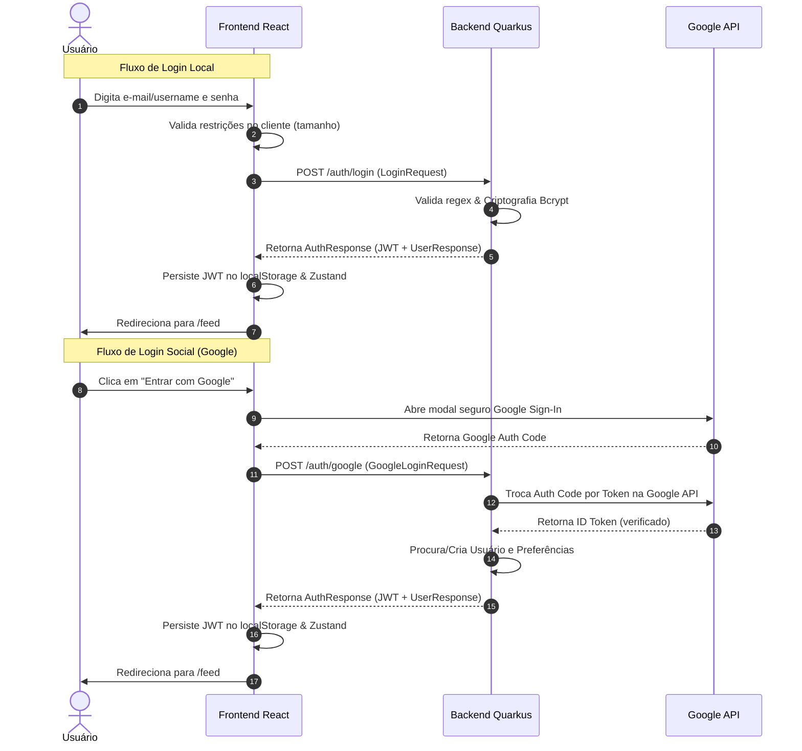

# Integração Ponta a Ponta: Fluxo de Autenticação e Segurança

Este documento descreve a correlação completa do fluxo de **Autenticação e Segurança** entre o cliente (Frontend React) e o servidor (Backend Quarkus Java), detalhando a troca de payloads, gerenciamento de estado e proteção de rotas.

---

## 1. Visão Geral do Fluxo

---

## 2. Correlação Técnica de Arquivos e Classes

| Responsabilidade | Componente Frontend (React) | Componente Backend (Quarkus) |
|---|---|---|
| **Formulário / API Endpoint** | `src/pages/Home.jsx` | `AuthResource.java` (`POST /auth/login`) |
| **Registro de Conta** | Formulário de Sign-Up no cliente | `AuthResource.java` (`POST /auth/register`) |
| **Integração com Google** | `@react-oauth/google` | `GoogleAuthService.java` e `GoogleAuthClient.java` |
| **Modelo de Dados (DTO)** | Objeto javascript de sessão | `RegisterRequest`, `LoginRequest`, `AuthResponse` |
| **Criptografia / Tokens** | — (Salvo no `localStorage`) | `BcryptUtil` (hashing) e `JWTParser` / Signer |
| **Sessão Reativa** | `useAuthStore` (Zustand) | `CurrentUser.java` (Contexto reativo JWT) |
| **Bloqueio de Rotas** | `<ProtectedRoute />` | Anotação `@Authenticated` (JAX-RS Guards) |

---

## 3. Detalhamento de Fluxos Integrados

### A. Fluxo de Registro Local
1. **Frontend**: O usuário preenche o formulário de cadastro. O cliente valida localmente os campos: e-mail no formato correto, username alfanumérico com underline (`^[a-zA-Z0-9_]{3,30}$`), e senha entre 8 e 30 caracteres. Dispara chamada HTTP para `POST /auth/register` enviando o `RegisterRequest`.
2. **Backend**: O `AuthService.java` recebe os dados. Ele executa uma verificação manual rigorosa de formato e duplicidade no banco (e-mail ou username já cadastrados). 
3. **Criação de Dependências**: Se a conta for criada com sucesso, o backend criptografa a senha com **Bcrypt**, persiste a entidade `User` e `AuthProvider` e aciona o domínio de preferências para criar o registro padrão (`UserPreference`) do tema `light` e idioma `pt-BR`.
4. **Resposta**: Retorna o DTO `AuthResponse` contendo o token JWT gerado e os dados simplificados do perfil do usuário. O frontend salva o JWT no `localStorage`, atualiza a store do Zustand (`useAuthStore`) e redireciona o usuário para o `/feed`.

### B. Fluxo do Google OAuth2 (Auth Code)
1. **Frontend**: O botão do Google renderiza o fluxo de captura utilizando a Google Identity Services API. Após login no Google, o browser do usuário recebe um **Authorization Code** temporário e o envia ao backend via `POST /auth/google`.
2. **Backend**: O `GoogleAuthService.java` captura o código e, utilizando o MicroProfile REST Client (`GoogleAuthClient.java`), troca-o de forma segura pelo ID Token diretamente no servidor da Google.
3. **Account Linking (Vínculo de Contas)**:
   - Se o e-mail do Google já estiver associado a uma conta local cadastrada na plataforma Transcendence, o backend associa o provedor do Google (`GOOGLE`) a essa conta existente de forma transparente.
   - Se o usuário não existir, cria-se uma nova conta de usuário, gerando um username de forma inteligente a partir do prefixo do e-mail do Google (adicionando sufixos numéricos em caso de colisão com usernames de terceiros).
4. **Resposta**: Retorna a sessão JWT equivalente ao login local.

### C. Validação de Sessão no Carregamento (Startup)
Sempre que a aplicação React é aberta ou recarregada:
1. O React Router verifica a rota atual. Se for privada, ativa o `<ProtectedRoute />`.
2. Se a store possuir um JWT salvo no `localStorage`, o Axios anexa o cabeçalho `Authorization: Bearer <JWT>` e dispara uma chamada reativa rápida para `/me` (`MeResource.java`).
3. O backend intercepta o token JWT, extrai com segurança a claim `uid` do usuário logado via `CurrentUser.id()` e consulta a entidade `User` no banco.
4. Se o usuário estiver ativo e o token for válido, o backend responde com `UserResponse (200 OK)` e a interface renderiza o feed. Caso o token esteja expirado, o interceptor global do Axios no frontend captura o erro `401 Unauthorized`, limpa a store do Zustand e redireciona o usuário para a tela inicial de login.
