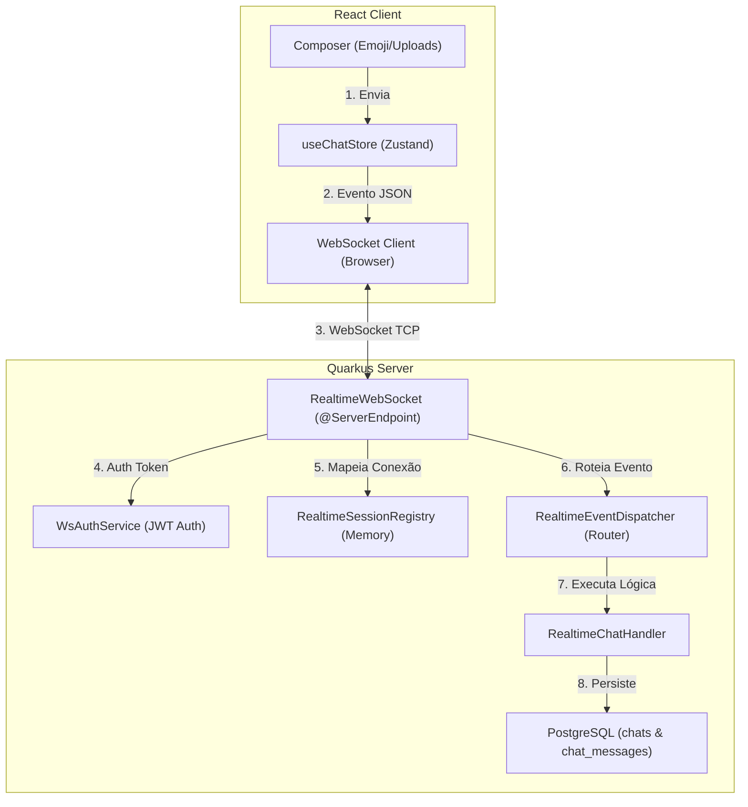

# Integração Ponta a Ponta: Chat e Tempo Real (WebSockets)

Este documento detalha o fluxo bidirecional de mensagens instantâneas, indicadores de digitação e gerenciamento de sessões reativas integrando o cliente (Zustand/WebSocket React) e o servidor (Quarkus WebSockets Next).

---

## 1. Visão Geral da Arquitetura WebSocket

---

## 2. Correlação Técnica de Arquivos e Classes

| Responsabilidade | Componente Frontend (React) | Componente Backend (Quarkus) |
|---|---|---|
| **Conexão WebSocket** | `src/hooks/useWebSocket.js` (ou hook similar) | `RealtimeWebSocket.java` (`/ws/realtime`) |
| **Autenticação de Conexão**| Query string `?token=<JWT>` | `WsAuthService.java` (SmallRye JWT parser) |
| **Gerenciamento de Canais**| `CHAT_SUBSCRIBE` / `CHAT_UNSUBSCRIBE` | `RealtimeSessionRegistry.java` (Memory indexes) |
| **Criação de Mensagem** | `useChatStore.js` (Ação sendMessage) | `ChatMessageService.java` & `ChatMessage.java` |
| **Interface de Conversa** | `src/features/chat/components/` | `ChatResource.java` (REST de salas/membros) |
| **Indicador de Digitação** | Temporizador Debounce reativo | Eventos `TYPING_START` e `TYPING_STOP` |

---

## 3. Detalhamento de Fluxos Integrados

### A. Fluxo de Conectividade e Autenticação
1. **Frontend**: Ao completar o login e renderizar o App Shell protegido, o frontend abre uma conexão de WebSocket apontando para `ws://api.videa.local/ws/realtime?token=<JWT>`.
2. **Backend**: O Quarkus recebe a conexão em `RealtimeWebSocket.java`. Ele extrai o JWT da query string e o valida no `WsAuthService.java`.
   - Se o token estiver corrompido ou ausente, fecha o socket reativamente enviando a mensagem `1008` (Not Authorized).
   - Se for bem-sucedido, cria um objeto `RealtimeConnection` in-memory contendo os metadados do usuário e o registra no `RealtimeSessionRegistry.java` nas chaves de busca rápida concorrente.

### B. Fluxo de Envio e Broadcast de Mensagens
1. **Frontend**: O usuário insere um texto no composer do chat e pressiona Enter. A ação do Zustand cria o payload JSON e o envia através da conexão ativa de WebSocket como o tipo de evento `SEND_MESSAGE`.
2. **Backend**: O evento de texto é recebido na rota `@OnTextMessage` do WebSocket e encaminhado ao `RealtimeEventDispatcher.java` que delega para `RealtimeChatHandler.sendMessage()`.
3. **Persistência e Relações**: O handler chama a classe `ChatMessageService.java` de forma transacional para gravar a mensagem no banco de dados Postgres (`ChatMessage` entity). Valida se o usuário é participante do chat (`ChatParticipant`), resolve o tipo de mensagem (texto ou mídia) e se há respostas (`replyToId`).
4. **Entrega Ultrarrápida**:
   - Em vez de fazer com que outros membros façam polling na API, o backend descobre quem são todos os participantes online daquela conversa chamando `ChatParticipant.find(...)` e cruzando os IDs com o `RealtimeSessionRegistry.java`.
   - Dispara imediatamente um broadcast do tipo de evento `MESSAGE_CREATED` via WebSocket apenas para os participantes online.
   - O frontend de cada participante ativo captura o evento reativamente e adiciona a nova mensagem à thread na tela sem atrasos.

### C. Fluxo de Indicador de Digitação (Debounced Indicators)
1. **Frontend**: À medida que o usuário digita na caixa de texto do chat, o React dispara um manipulador de eventos. Para evitar sobrecarregar o socket a cada caractere digitado, o cliente implementa um **temporizador de debounce (atraso)**:
   - No primeiro caractere $\to$ envia o evento WebSocket `TYPING_START` para o backend.
   - Reseta um timer de 2 segundos. Se o usuário parar de digitar por 2 segundos $\to$ envia `TYPING_STOP`.
2. **Backend**: O `RealtimeChatHandler.java` recebe o sinal. Ele captura as conexões ativas que estão inscritas explicitamente na visualização aberta daquele chat (`subscribedChatIds` no SessionRegistry) e replica os eventos `TYPING_START`/`TYPING_STOP` contendo o ID e username do emissor para todos os outros navegadores ativos conectados naquela sala, excluindo o próprio remetente.
3. **Frontend**: A tela dos outros membros desenha animadamente o indicador visual de que o remetente está digitando de forma instantânea.
