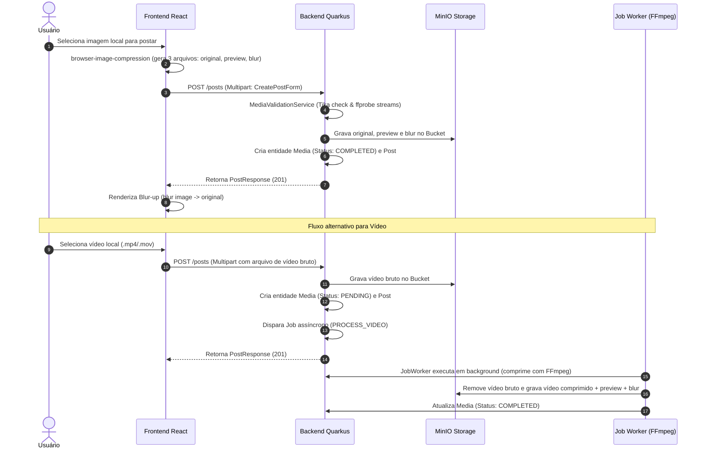

# Integração Ponta a Ponta: Feed de Posts, Upload de Mídias e Interações

Este documento descreve como a timeline do feed de posts, o envio de arquivos de imagem/vídeo, o sistema de curtidas otimistas e os comentários são integrados entre o frontend React e o backend Quarkus.

---

## 1. O Pipeline de Upload e Processamento de Mídias

---

## 2. Correlação Técnica de Arquivos e Classes

| Responsabilidade | Componente Frontend (React) | Componente Backend (Quarkus) |
|---|---|---|
| **Criação do Post** | `CreatePostModal.jsx` | `PostResource.java` (`POST /posts`) |
| **Listagem do Feed** | `Feed.jsx` | `PostResource.java` (`GET /posts`) |
| **Compressão no Cliente**| `browser-image-compression` | — (Salva banda de rede do servidor) |
| **Recorte de Imagem** | `react-easy-crop` | — (Processado via canvas no browser) |
| **Validação de Binário** | Checagem básica de extensão | `MediaValidationService.java` (Tika) |
| **Curtir Post** | Optimistic UI (coração vermelho) | `LikeService.java` (`ON CONFLICT DO NOTHING`) |
| **Comentários** | Seção de comentários paginada | `CommentResource.java` & `CommentService.java` |
| **Processamento Assíncrono**| Polling reativo de status de mídia | `JobWorker.java` & `ProcessVideoHandler.java` |

---

## 3. Detalhamento de Fluxos Integrados

### A. Fluxo de Publicação de Imagem com Progressive Blur (Blur-up)
1. **Frontend (Otimização local)**: O usuário seleciona uma imagem pesada. Para economizar banda de rede móvel e CPU do servidor, o frontend realiza o redimensionamento de forma assíncrona no cliente usando a biblioteca `browser-image-compression`, gerando três binários: a imagem original cortada pelo `react-easy-crop`, uma versão otimizada mais leve (`previewFile`) e uma miniatura minúscula de alta compressão e desfocada (`blurFile`). Os 3 arquivos são enviados via `multipart/form-data` para `POST /posts`.
2. **Backend (Validação de bytes)**: O `PostService.java` recebe os arquivos. Ele aciona o `MediaValidationService.java` para validar as assinaturas físicas de bytes (magic numbers) via Apache Tika, assegurando que o binário não é malicioso.
3. **Escrita**: Persiste a imagem original, preview e blur no MinIO e grava a associação polimórfica na tabela `media` com status `COMPLETED`. Retorna o `PostResponse` contendo os caminhos.
4. **UX Premium no Frontend (Blur-up)**: Ao renderizar o feed, o browser desenha imediatamente na tela a miniatura borrada ultraleve (`pathBlur`). Enquanto o navegador baixa a imagem principal (`pathOriginal`) em background, a miniatura borrada serve como um placeholder de carregamento agradável. Quando a imagem final termina de baixar, o frontend faz uma transição CSS suave de opacidade (`blur-out`), evitando qualquer quebra ou salto visual na timeline.

### B. O Mecanismo de Likes Otimistas (Optimistic UI)
1. **Frontend**: Quando o usuário clica no ícone de coração de um post para curtir, o frontend não espera o retorno lento da API HTTP. Ele atualiza **imediatamente** a tela (pinta o coração de vermelho e incrementa o saldo visual de curtidas). Simultaneamente, dispara em background a requisição HTTP `POST /posts/{id}/like`.
2. **Backend**: O `LikeService.java` executa uma inserção segura no banco utilizando `ON CONFLICT DO NOTHING`. Se a linha for inserida de fato (primeira curtida do usuário), o backend incrementa atomicamente o contador `likeCount` na tabela `posts` via JPQL. Se o usuário já tiver curtido antes, ignora o insert sem gerar erros e retorna sucesso.
3. **Resiliência**: Se a requisição de rede do frontend falhar (ex: queda de conexão do usuário), o interceptor de erros reverte de forma transparente o estado visual do coração e decrementa o saldo de likes na tela, exibindo um Toast amigável na tela informando a falha de conexão.

### C. Fluxo de Comentários
1. **Frontend**: Clicar em comentar abre a gaveta de comentários. Carrega a lista via `GET /comment/{postId}` de forma paginada.
2. **Backend**: O `CommentService.java` carrega os comentários usando paginação e adota um **cache in-memory reativo** para os avatares dos autores para evitar consultas repetitivas N+1 ao MinIO de pessoas que comentaram mais de uma vez.
3. **Remoção**: A deleção de um comentário adquire um bloqueio de escrita pessimista (`PESSIMISTIC_WRITE`) na linha do banco, decrementa o contador `commentCount` no post correspondente, executa o soft delete e apaga fisicamente (hard delete) todas as curtidas associadas ao comentário removido.
