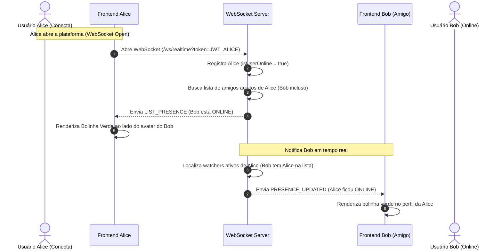

# Integração Ponta a Ponta: Grafo Social, Relações e Presença Online

Este documento correlaciona o funcionamento do grafo social (solicitações de amizade com banco espelhado, follow/unfollow direcionado) e o monitoramento em tempo real de presença online de amigos conectando a interface do usuário e o backend.

---

## 1. Visão Geral do Fluxo de Presença Reativa

---

## 2. Correlação Técnica de Arquivos e Classes

| Responsabilidade | Componente Frontend (React) | Componente Backend (Quarkus) |
|---|---|---|
| **Página de Amigos** | `Friends.jsx` (Abas Radix) | `FriendshipResource.java` (`/friendships`) |
| **Envio de Convite** | Botão "Adicionar amigo" no perfil | `FriendshipService.java` (`sendRequest`) |
| **Aceitar Convite** | Aba "Solicitações" (Confetes e UI) | `FriendshipService.java` (`acceptRequest` - Mirror) |
| **Presença In-Memory** | Store do Zustand (`presenceState`) | `PresenceService.java` e `RealtimePresenceHandler` |
| **Status de Follow** | Contador e Botão dinâmico na UI | `Follow.java` (Panache Entity no backend) |
| **Eventos de Status** | Bolinha verde brilhante animada | `RealtimeEventType.PRESENCE_UPDATED` |

---

## 3. Detalhamento de Fluxos Integrados

### A. O Modelo de Banco de Dados Espelhado (Mirror) nas Amizades
Para manter a reciprocidade bi-direcional e simplificar queries sem precisar realizar buscas lentas cruzando tabelas or em banco relacional:
1. **Alice envia convite**: Ao clicar em "Adicionar", o frontend dispara `POST /friendships/request/{bobId}`. O `FriendshipService.java` cria **um único registro** no banco Postgres: `userId = Alice, friendId = Bob, status = PENDING`.
2. **Bob visualiza**: Ao acessar a aba de Solicitações, o frontend de Bob busca `GET /friendships/requests/pending`. O backend lista os registros onde Bob é o destinatário (`friendId = Bob` e `status = PENDING`).
3. **Bob aceita (Geração do Mirror)**: Bob clica em "Aceitar". O frontend dispara `POST /friendships/accept/{friendshipId}` e exibe efeitos de confete na tela. De forma transacional no backend:
   - O registro original passa a ter `status = ACCEPTED`.
   - Cria-se imediatamente um **segundo registro espelhado** invertendo a ordem: `userId = Bob, friendId = Alice, status = ACCEPTED`.
   - A partir desse momento, as amizades são listadas de forma extremamente rápida consultando apenas indexações da coluna de origem `userId` do usuário logado.
4. **Desfazimento**: Ao remover um amigo (`DELETE /friendships/{id}`), o sistema localiza ambos os registros espelhados associados e executa a exclusão física (**hard delete**) simultânea no Postgres.

### B. O Fluxo de Presença Online em Tempo Real (WebSocket + Cache In-Memory)
1. **Inicialização**: Bob já está online. Alice abre a aplicação e conecta no WebSocket.
2. **Auto-Inscrição de Presença**: O `RealtimePresenceHandler.java` intercepta a conexão reativa de Alice:
   - Consulta a tabela `friendships` e obtém todos os amigos aceitos de Alice.
   - Registra no `PresenceService` em memória que a conexão ativa de Alice é uma **observadora (watcher)** do status dos seus amigos, e vice-versa.
   - Devolve para o frontend de Alice um evento `LIST_PRESENCE` contendo o status instantâneo atualizado de todos os amigos (indicando que Bob está online).
3. **Notificação Cruzada**: O backend localiza que Bob está online e ativo na plataforma. Dispara em background via socket um evento `PRESENCE_UPDATED` com a flag `online = true` para a conexão ativa de Bob, avisando que Alice acabou de entrar.
4. **Resiliência Multi-Abas**: Se Bob fechar uma das abas do navegador, seu status continua ativo na plataforma. O status de Bob só passa a ser notificado como `online = false` (offline) para seus amigos quando a **última conexão reativa** associada ao seu ID no `RealtimeSessionRegistry` for fechada, evitando falsos gatilhos de queda por recarregamento de página.
