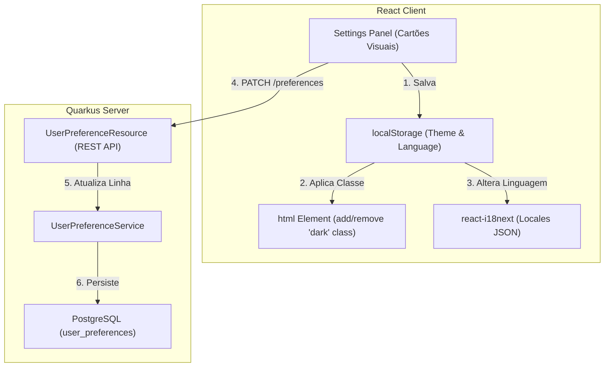

# Integração Ponta a Ponta: Preferências, Modo Escuro e Internacionalização (i18n)

Este documento correlaciona o fluxo de **Preferências do Usuário** entre o cliente (Zustand, classes de tema HTML e react-i18next) e o servidor (Quarkus APIs e banco de dados).

---

## 1. Visão Geral do Módulo de Preferências

---

## 2. Correlação Técnica de Arquivos e Classes

| Responsabilidade | Componente Frontend (React) | Componente Backend (Quarkus) |
|---|---|---|
| **Painel de Configurações**| `src/features/settings/` | `UserPreferenceResource.java` (`/preferences`) |
| **Inicialização Padrão** | Criação de conta local ou Google | `UserPreference.createDefaultPreferences()` |
| **Troca de Tema (UI)** | Cartões ilustrativos selecionáveis | `ThemePreferenceDTO.java` |
| **Aplicação Física (CSS)** | Toggle de classe `dark` em `<html>` | Variantes `dark:` no Tailwind CSS v4 |
| **Idioma (Traduções)** | `react-i18next` (locales JSON) | `LanguagePreferenceDTO.java` |
| **Persistência Offline** | Salvo no `localStorage` do browser | Tabela `user_preferences` no banco Postgres |

---

## 3. Detalhamento de Fluxos Integrados

### A. O Fluxo de Inicialização de Preferências
1. **Gatilho de Criação**: Durante o registro de uma nova conta de usuário (seja local através do preenchimento de e-mail e senha, ou social através da autenticação via Google OAuth2 no backend), o `AuthService.java` aciona o método de fábrica estático `UserPreference.createDefaultPreferences(User, now)`.
2. **Definições Padrão**: O banco de dados PostgreSQL é populado imediatamente com um registro de preferências de interface associado 1-1 ao novo usuário contendo os padrões:
   - `theme = "light"`
   - `language = "pt-BR"`

### B. O Controle Dinâmico do Modo Escuro (Dark Mode)
1. **Frontend (Seleção Gráfica)**: O usuário abre as configurações e clica no cartão visual de "Modo Escuro". 
   - A store de configurações atualiza o tema para `"dark"`.
   - Adiciona reativamente a classe `dark` na tag raiz `<html>` do documento.
   - Grava a escolha no `localStorage`.
   - O Tailwind CSS v4 lê instantaneamente a classe `dark` e re-renderiza todas as cores e bordas da tela usando a variante escura das cores declaradas (com transição CSS de cores suave de 300ms).
2. **Sincronização com o Servidor**: 
   - Paralelamente ao efeito visual imediato na tela, o frontend dispara uma chamada assíncrona HTTP do tipo `PATCH /preferences/theme` passando a DTO `ThemePreferenceDTO` com o valor `"dark"`.
   - O `UserPreferenceService.java` captura a chamada, autentica via token JWT e atualiza a propriedade na tabela `user_preferences` do banco de dados relacional.
   - Isso garante que, se o usuário logar na plataforma Transcendence a partir de outro computador ou navegador no futuro, a interface será pintada em modo escuro de forma automática no startup.

### C. O Mecanismo Reativo de Troca de Idioma (i18n)
1. **Frontend (Namespaces JSON)**: O suporte multilíngue utiliza dicionários JSON divididos em namespaces por feature (`chat.json`, `feed.json`, `auth.json`) dentro do diretório `src/i18n/locales/` das pastas de idiomas (`pt-BR`, `en-US`, `es-ES`).
2. **Troca em Tempo Real**: Clicar no seletor de idiomas aciona `i18n.changeLanguage(newLang)`. O hook reativo `useTranslation` de cada componente ativo na tela substitui instantaneamente todos os rótulos de botões e placeholders de texto de forma imediata (Hot Reloading de i18n reativo).
3. **Sincronização**: Dispara uma chamada assíncrona reativa `PATCH /preferences/language` com `LanguagePreferenceDTO` contendo o novo locale (ex: `"en-US"`) para persistência no banco. O motor de busca avançado (`UserDiscoveryService`) lê essa coluna de idioma para poder realizar filtragens geográficas e linguísticas nos resultados de descoberta de novos amigos de forma otimizada.
