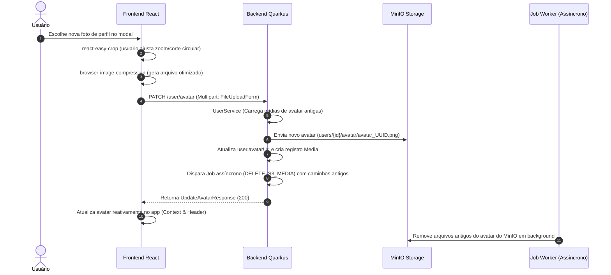

# Integração Ponta a Ponta: Perfis de Usuários, Avatares e Busca Avançada

Este documento descreve a correlação completa do domínio de **Perfis de Usuários**, detalhando o fluxo de upload de avatares com recorte no cliente e exclusão física assíncrona no storage, e o motor de busca avançada parametrizada insensível a acentos (accent-insensitive).

---

## 1. O Fluxo de Upload e Crop de Avatar

---

## 2. Correlação Técnica de Arquivos e Classes

| Responsabilidade | Componente Frontend (React) | Componente Backend (Quarkus) |
|---|---|---|
| **Página de Perfil** | `Profile.jsx` | `UserResource.java` (`GET /user/{username}`) |
| **Recorte Visual** | `react-easy-crop` (UI interativa) | — (Processado em canvas antes do POST) |
| **Upload de Imagem** | Formulário multipart em React | `UserResource.java` (`PATCH /user/avatar`) |
| **Expurgo de Mídia** | — (Transparente para o usuário) | `JobService.java` (`createDeleteMediaJob`) |
| **Resolução de Avatar**| `useAuth()` (React Context) | `UserAvatarService.java` (Batch check) |
| **Busca de Perfis** | Barra de busca e filtros na UI | `UserDiscoveryService.java` (HQL Dinâmico) |
| **Accent-Insensitivity**| — | Função PostgreSQL `f_unaccent(coluna)` |

---

## 3. Detalhamento de Fluxos Integrados

### A. Fluxo de Edição de Avatar
1. **Frontend (Corte no Canvas)**: O usuário abre as configurações de perfil e seleciona uma imagem. O frontend renderiza a imagem em um canvas móvel de corte usando `react-easy-crop` permitindo zoom e deslocamento. Ao salvar, gera-se o arquivo recortado em alta fidelidade e uma versão otimizada leve.
2. **Envio**: Envia o binário via `multipart/form-data` para `PATCH /user/avatar`.
3. **Backend (Substituição e Limpeza de Lixo no Storage)**:
   - O `UserService.java` recebe o arquivo e o valida via Apache Tika.
   - Consulta a tabela `media` e extrai os caminhos das **mídias de avatar antigas** associadas ao ID daquele usuário (caminhos originais, preview e blur).
   - Grava a nova imagem no MinIO e atualiza a referência `avatarUrl` no banco da entidade `User`.
   - Para evitar que o disco ou o bucket MinIO fiquem poluídos com gigabytes de imagens de avatar desatualizadas e órfãs, o backend cria uma lista contendo os caminhos dos arquivos antigos e aciona o módulo de Jobs assíncronos: `JobService.createDeleteMediaJob(caminhosAntigos)`.
   - O job roda em background em poucos segundos e remove fisicamente todos os objetos órfãos do storage MinIO.
4. **Atualização**: O backend retorna a nova URL de avatar segura assinada no DTO `UpdateAvatarResponse`. O frontend captura o retorno e atualiza o contexto reativo de autenticação, refletindo a nova imagem de perfil em todos os cabeçalhos e janelas de chat de forma instantânea.

### B. O Motor de Busca Avançada (Accent-Insensitive)
1. **Frontend**: O usuário digita um termo de busca (ex: "Érick") na barra de pesquisa e seleciona filtros adicionais de localização e idioma preferencial. Dispara `GET /user/search` com os parâmetros.
2. **Backend (HQL Dinâmica e PostgreSQL functions)**:
   - O `UserDiscoveryService.java` intercepta a requisição e monta dinamicamente a consulta HQL.
   - Para evitar que buscas falhem por causa de acentuações inseridas na digitação do usuário ou salvas no banco (ex: o usuário digitou "erick" mas o nome salvo é "Érick"), o sistema aplica a função nativa de banco do Postgres **`f_unaccent()`** em nível de banco de dados nos campos de busca: `WHERE f_unaccent(lower(u.name)) LIKE f_unaccent(lower(:query))`.
   - Isso garante uma busca extremamente tolerante e precisa (Accent-Insensitive).
3. **Enriquecimento em lote**: O resultado da busca não traz apenas dados estáticos de usuário. O backend cruza em lote o resultado obtido com o status das preferências (`UserPreference`), saldo de amigos em comum (mutual friends count via subquery HQL) e o estado exato de amizade (`Friendship` joins), retornando a lista completamente rica e estruturada para a tela de resultados do frontend.
