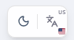
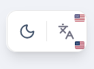

## Support for Additional Browsers

### Matriz de suporte de navegador

**Browsers suportados:**  Google Chrome, Microsoft Edge, Mozilla Firefox
**Versões suportadas:** últimas 2 versões estáveis de cada navegador
**Sistema operacional de referência:** Linux (ambiente principal de desenvolvimento e validação)
**Observação de escopo:** Safari não faz parte do escopo obrigatório desta entrega por ausência de ambiente macOS para validação completa.

**Nota:** A validação feita no Chromium é considerada suficiente para cobrir o Microsoft Edge, já que ambos compartilham a mesma engine (Blink). No entanto, pequenas diferenças visuais podem ocorrer devido a variações entre distribuições ou versões dos navegadores. Caso essas diferenças sejam identificadas, elas devem ser avaliadas e tratadas como ajustes visuais de baixo impacto, sem comprometer o funcionamento geral do sistema.

---

### Estratégia de Validação

- **Automação:** Vitest + Playwright Browser Mode (chromium + firefox)
- **Validação Manual:** smoke test dos fluxos críticos
- **Critério de aprovação:** fluxo funcional + UI/UX consistente entre navegadores suportados

---

### Checklist de regressão funcional (por navegador)

**Legenda:**

- ✅ Passou
- ⚠️ Passou com diferença
- ❌ Falhou
- N/T Não testado


| Fluxo/Feature                                       | Chromium (Chrome/Edge) | Firefox | Observações                                          |
| --------------------------------------------------- | ---------------------- | ------- | ---------------------------------------------------- |
| Login com credenciais                               | ✅                      | ✅       |                                                      |
| Logout                                              | ✅                      | ✅       |                                                      |
| Navegação entre páginas protegidas                  | ✅                      | ✅       |                                                      |
| Carregamento da página de Chat                      | ✅                      | ✅       |                                                      |
| Envio de mensagem no Chat                           | ✅                      | ✅       |                                                      |
| Ordenação de conversas por recência                 | ✅                      | ✅       |                                                      |
| Renderização de mídia em mensagem (img/video/áudio) | ✅                      | ✅       |                                                      |
| Feed: criar post de texto                           | ✅                      | ✅       |                                                      |
| Feed: criar post com foto/vídeo                     | ✅                      | ✅       |                                                      |
| Feed: comentar post                                 | ✅                      | ✅       |                                                      |
| Perfil: editar avatar/imagem                        | ✅                      | ✅       |                                                      |
| Modais principais (abrir/fechar/interações)         | ✅                      | ✅       |                                                      |
| i18n: troca de idioma e textos no Chat              | ✅                      | ✅       |                                                      |
| Responsividade básica (desktop e largura menor)     | ✅                      | ✅       |                                                      |


---

### Resultado dos testes automatizados

- Comando executado:
  - `npx vitest run`
- Resultado Chromium:
	```sh
		 RUN  v4.1.2 /home/thaismeneses/Transcendence/frontend

	✓  0  src/app/providers/__tests__/AuthProvider.test.jsx (1 test) 54ms
	✓  0  src/app/routes/__tests__/PrivateRoute.test.jsx (2 tests) 97ms
	✓  0  src/features/auth/__tests__/AuthContainer.test.jsx (1 test) 607ms
	✓ renders auth container  595ms
	✓  storybook (chromium)  src/design-system/primitives/Button/Button.stories.jsx (3 tests) 5427ms
	✓ Disabled  1349ms
	✓ Primary  3456ms
	✓ All Variants  611ms
	✓  storybook (chromium)  src/design-system/primitives/Label/Label.stories.jsx (6 tests) 7281ms
	✓ Playground  2044ms
	✓ With Input  2691ms
	✓ Disabled  505ms
	✓ With Error  557ms
	✓ Form Example  583ms
	✓ All States  893ms
	✓  storybook (chromium)  src/design-system/primitives/Card/Card.stories.jsx (7 tests) 7467ms
	✓ Default  1785ms
	✓ With Action  3030ms
	✓ Form Card  729ms
	✓ Minimal  340ms
	✓ Playground  341ms
	✓ With Button  450ms
	✓ With Button Loading  783ms
	✓  storybook (chromium)  src/stories/Button.stories.js (5 tests) 8227ms
	✓ Primary  6758ms
	✓ Secondary  774ms
	✓  storybook (chromium)  src/design-system/primitives/Separator/Separator.stories.jsx (4 tests) 8112ms
	✓ Default  6965ms
	✓ Vertical  579ms
	✓ In Content  311ms
	✓  storybook (chromium)  src/design-system/primitives/Scroll/Scroll.stories.jsx (3 tests) 8097ms
	✓ Default  7564ms
	✓ Short Content  302ms
	✓  storybook (chromium)  src/design-system/primitives/Textarea/Textarea.stories.jsx (5 tests) 8133ms
	✓ Default  6586ms
	✓ With Max Length  834ms
	✓ Invalid  311ms
	✓  storybook (chromium)  src/design-system/primitives/Input/Input.stories.jsx (6 tests) 8263ms
	✓ Playground  6842ms
	✓ With Icon  665ms
	✓ Password  311ms
	✓  storybook (chromium)  src/design-system/primitives/Tabs/Tabs.stories.jsx (4 tests) 8678ms
	✓ Default  7557ms
	✓ Filled  426ms
	✓ Disabled  324ms
	✓ With Form  356ms
	✓  storybook (chromium)  src/design-system/primitives/TextWithLink/TextWithLink.stories.jsx (6 tests) 8724ms
	✓ Default  7520ms
	✓  storybook (chromium)  src/design-system/primitives/Avatar/Avatar.stories.jsx (6 tests) 8605ms
	✓ Playground  7460ms
	✓ Status Variants  307ms
	✓  storybook (chromium)  src/stories/Page.stories.js (2 tests) 3149ms
	✓ Logged Out  2881ms
	✓  storybook (chromium)  src/stories/Header.stories.js (2 tests) 1396ms
	✓ Logged In  1330ms
	✓  storybook (chromium)  src/design-system/primitives/FileUploadButton/FileUploadButton.stories.jsx (3 tests) 233ms

	Test Files  17 passed (17)
		Tests  66 passed (66)
	Start at  17:45:02
	Duration  24.56s (transform 4.00s, setup 49.99s, import 19.33s, tests 92.55s, environment 4.12s)
	```

- Resultado Firefox:

	```sh
	 RUN  v4.1.2 /home/thaismeneses/Transcendence/frontend

	✓  0  src/app/providers/__tests__/AuthProvider.test.jsx (1 test) 39ms
	✓  0  src/app/routes/__tests__/PrivateRoute.test.jsx (2 tests) 61ms
	✓  0  src/features/auth/__tests__/AuthContainer.test.jsx (1 test) 238ms
	✓  storybook (firefox)  src/design-system/primitives/Tabs/Tabs.stories.jsx (4 tests) 7691ms
	✓ Default  5529ms
	✓ Filled  1158ms
	✓ Disabled  582ms
	✓ With Form  408ms
	✓  storybook (firefox)  src/design-system/primitives/Input/Input.stories.jsx (6 tests) 8682ms
	✓ Playground  3030ms
	✓ With Icon  3862ms
	✓ Password  903ms
	✓ Error  373ms
	✓  storybook (firefox)  src/design-system/primitives/Card/Card.stories.jsx (7 tests) 10080ms
	✓ Default  3472ms
	✓ With Action  1379ms
	✓ Form Card  3448ms
	✓ Minimal  659ms
	✓ Playground  413ms
	✓ With Button  470ms
	✓  storybook (firefox)  src/design-system/primitives/TextWithLink/TextWithLink.stories.jsx (6 tests) 7772ms
	✓ Default  6188ms
	✓ Multiple Links  346ms
	✓ Custom Style  513ms
	✓  storybook (firefox)  src/design-system/primitives/Textarea/Textarea.stories.jsx (5 tests) 6831ms
	✓ Default  5475ms
	✓ Invalid  539ms
	✓ With Label  334ms
	✓  storybook (firefox)  src/design-system/primitives/Button/Button.stories.jsx (3 tests) 2837ms
	✓ Disabled  1964ms
	✓ Primary  355ms
	✓ All Variants  513ms
	✓  storybook (firefox)  src/design-system/primitives/Label/Label.stories.jsx (6 tests) 4474ms
	✓ Playground  2546ms
	✓ With Input  455ms
	✓ With Error  423ms
	✓ Form Example  455ms
	✓ All States  408ms
	✓  storybook (firefox)  src/design-system/primitives/Scroll/Scroll.stories.jsx (3 tests) 3693ms
	✓ Default  2788ms
	✓ Short Content  539ms
	✓ Long Text  362ms
	✓  storybook (firefox)  src/stories/Button.stories.js (5 tests) 4974ms
	✓ Primary  3222ms
	✓ Secondary  700ms
	✓ Small  307ms
	✓ Transcendence UI  532ms
	✓  storybook (firefox)  src/design-system/primitives/Avatar/Avatar.stories.jsx (6 tests) 4715ms
	✓ Playground  3317ms
	✓ Fallback  330ms
	✓ Sizes  519ms
	✓  storybook (firefox)  src/design-system/primitives/Separator/Separator.stories.jsx (4 tests) 4273ms
	✓ Default  2998ms
	✓ In Content  674ms
	✓ Semantic  313ms
	✓  storybook (firefox)  src/stories/Page.stories.js (2 tests) 1678ms
	✓ Logged Out  1057ms
	✓ Logged In  619ms
	✓  storybook (firefox)  src/stories/Header.stories.js (2 tests) 1770ms
	✓ Logged In  1657ms
	✓  storybook (firefox)  src/design-system/primitives/FileUploadButton/FileUploadButton.stories.jsx (3 tests) 1342ms
	✓ Playground  1209ms

	Test Files  17 passed (17)
		Tests  66 passed (66)
	Start at  17:50:16
	Duration  33.36s (transform 828ms, setup 64.63s, import 32.64s, tests 71.15s, environment 1.93s)


	```
---

### Limitações conhecidas por navegador

- Não foram identificadas limitações funcionais que restrinjam o uso nos diferentes navegadores.

---

### Conclusão de Compatibilidade

- Status geral da compatibilidade (Chrome/Edge/Firefox): **Aprovado**
	- Foi identificada uma pequena diferença visual no botão de seleção de idioma entre Chromium e Firefox. A funcionalidade permanece íntegra (sem impacto no uso), portanto o item é tratado como ajuste visual de baixo impacto, não como limitação funcional do browser.
	- Chromium (Chrome e Edge):
		<p align="center">
			<a href="">
				
			</a>
		</p>

	- Mozilla Firefox:
		<p align="center">
			<a href="">
				
			</a>
		</p>


